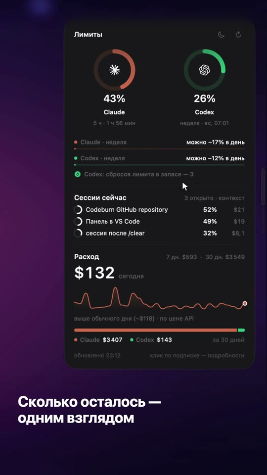
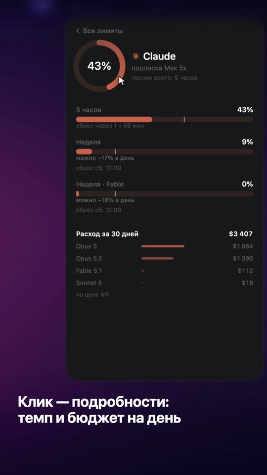
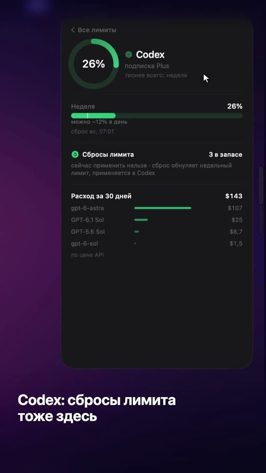
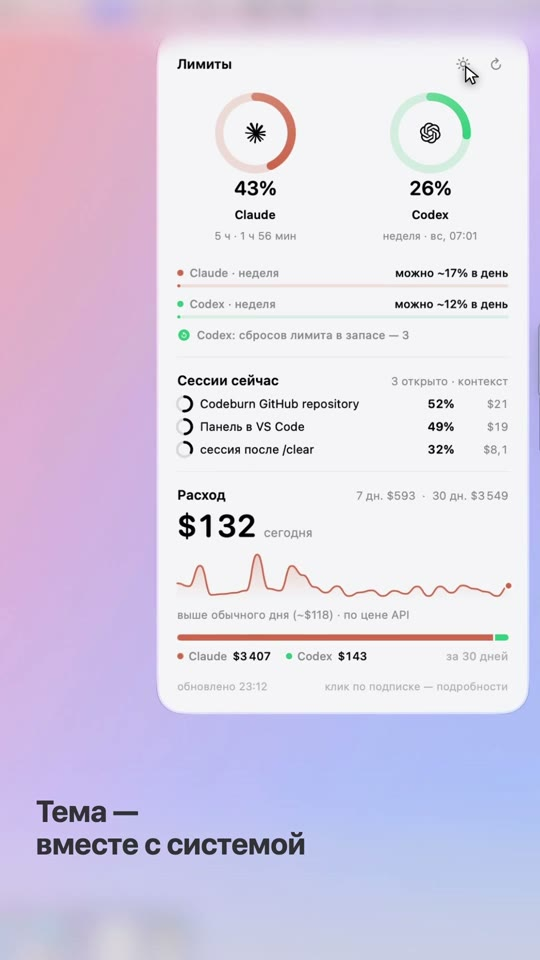
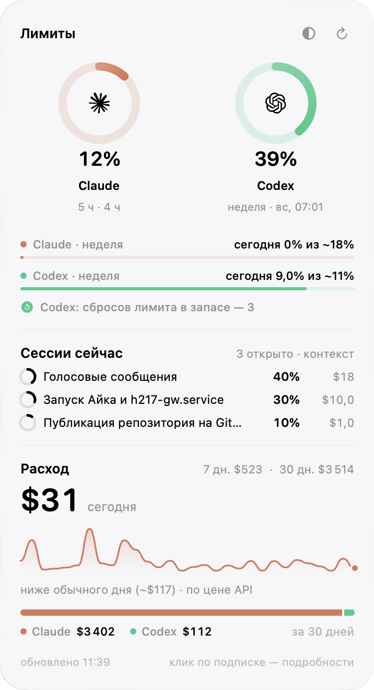

# Limity Dock

**Лимиты Claude и Codex — у края экрана Mac.** Подводишь курсор к правому краю — выезжает стеклянная панель: сколько лимита израсходовано, когда сброс, сколько можно тратить сегодня и во что обошёлся месяц.

<p align="center"></p>
<p align="center"><a href="docs/demo.mp4">Ролик в MP4</a></p>

## Зачем

Если работаешь в Claude Code или Codex весь день, лимит кончается внезапно — посреди задачи. Чтобы узнать, сколько осталось, приходится лезть в настройки или на сайт. Limity Dock держит эти цифры в одном движении мыши: не окно, не значок в строке меню, а тонкая ручка у края экрана, которая не мешает работать.

## Что умеет

<table>
<tr>
<td align="center" width="25%"><br><b>Всё одним взглядом</b></td>
<td align="center" width="25%"><br><b>Клик по Claude</b></td>
<td align="center" width="25%"><br><b>Клик по Codex</b></td>
<td align="center" width="25%"><br><b>День, ночь, авто</b></td>
</tr>
</table>

**Главный экран**
- **Кольца Claude и Codex** — сколько израсходовано и когда сброс. У Claude кольцо показывает 5-часовое окно, у Codex — недельное.
- **Бюджет на сегодня** — «сегодня 9% из ~11%»: сколько недельного лимита уже потрачено за день и сколько можно, чтобы хватило до сброса.
- **Сбросы лимита Codex** — сколько их в запасе.
- **Предупреждение о темпе** — если в нынешнем темпе лимит кончится раньше сброса, панель скажет когда: «Claude · неделя: в таком темпе кончится в чт».
- **Сессии сейчас** — какие сессии Claude Code открыты, насколько заполнен контекст каждой и сколько она стоила (см. ниже).
- **Расход** — сегодня, за 7 и 30 дней, график по дням и сравнение с обычным днём.

**Клик по подписке — подробности**
- Все окна лимита отдельно: 5 часов, неделя, недельные лимиты отдельных моделей — с отметкой «где ты должен быть сейчас», чтобы видеть, обгоняешь ли темп.
- Расход за 30 дней по моделям (Opus, Sonnet, GPT…).
- У Codex — сбросы лимита: сколько в запасе и можно ли применить сейчас.

**Остальное**
- **Уведомления macOS** при 80% и 90% лимита, когда контекст сессии переваливает за 60% и когда у Codex появляется новый сброс лимита. Каждое — один раз, без спама.
- Тема день / ночь / как в системе — значок в шапке панели.
- Ручку можно перетащить выше или ниже по краю. Правый клик по ней — меню: обновить, вернуть на место, тема, выход.
- Нет одной из подписок — её кольца просто не будет.
- Лёгкая: ~30 МБ памяти, процессор в покое не трогает.

<p align="center"><br><sub>Текущая версия, светлая тема</sub></p>

## Установка

Нужно: **macOS 26 (Tahoe) или новее** (панель на Liquid Glass) и вход в Claude Code и/или Codex на этом Маке.

1. Скачай `LimityDock.zip` из [Releases](../../releases/latest) и дважды кликни — в «Загрузках» появится папка `LimityDock`.
2. Открой Терминал и вставь:

   ```bash
   bash ~/Downloads/LimityDock/install.sh
   ```

3. У правого края экрана появится полупрозрачная ручка. Подведи к ней курсор.

При первом запуске macOS спросит:
- доступ к связке ключей для `security` — нажми «Всегда разрешать» (так читаются лимиты Claude);
- разрешение на уведомления — по желанию.

Установщик сам поставит [codeburn](https://github.com/getagentseal/codeburn) (через Homebrew или npm), скопирует программу в `~/Applications` и включит автозапуск. Посмотреть, что он сделает, ничего не меняя: `DRY=1 bash ~/Downloads/LimityDock/install.sh`.

Удалить: `bash ~/Downloads/LimityDock/uninstall.sh` — программа и автозапуск уходят в Корзину.

> Сборка не подписана Apple, поэтому установщик снимает с неё пометку «скачано из интернета». Не доверяешь готовой сборке — собери сам из исходников, это одна команда.

## Откуда цифры

Всё считается на твоём Маке. Лимиты — `codeburn quota` раз в 5 минут (он спрашивает их у Anthropic и OpenAI с твоим же входом), расход — `codeburn report` раз в 10 минут по локальным логам сессий. Сама программа никуда ничего не отправляет.

Расход в долларах — по ценам API. Если ты на подписке, это не счёт, а мера: сколько стоила бы та же работа по API.

**Сессии сейчас.** Процент контекста открытых сессий Claude Code программа читает из файлов `~/.claude/limity/*.json`. Их пишет отдельный мод Claude Code, которого в этом репозитории пока нет, — без него блок показывает «нет открытых», остальное работает.

## Сборка из исходников

Нужны Xcode Command Line Tools (`xcode-select --install`).

```bash
git clone https://github.com/akopyanaa333/limity-dock.git
cd limity-dock
bash build.sh
```

Собирает универсальное приложение (Apple Silicon + Intel), архив `dist/LimityDock.zip` и сразу ставит его тем же установщиком. Весь код — один файл `main.swift` (SwiftUI + AppKit).

---

### English

**Claude and Codex usage limits at the edge of your Mac screen.** Hover the right edge — a Liquid Glass panel slides out with usage rings, reset times, today's budget for the weekly limit, open Claude Code sessions with context fill, and 30-day spend. Click a subscription for every limit window and per-model cost. macOS notifications at 80/90%. Requires macOS 26+, data via [codeburn](https://github.com/getagentseal/codeburn), nothing leaves your Mac. UI is in Russian.

Install: download `LimityDock.zip` from [Releases](../../releases/latest), unzip, run `bash ~/Downloads/LimityDock/install.sh`. Build from source: `bash build.sh`.

## Лицензия

[MIT](LICENSE)
